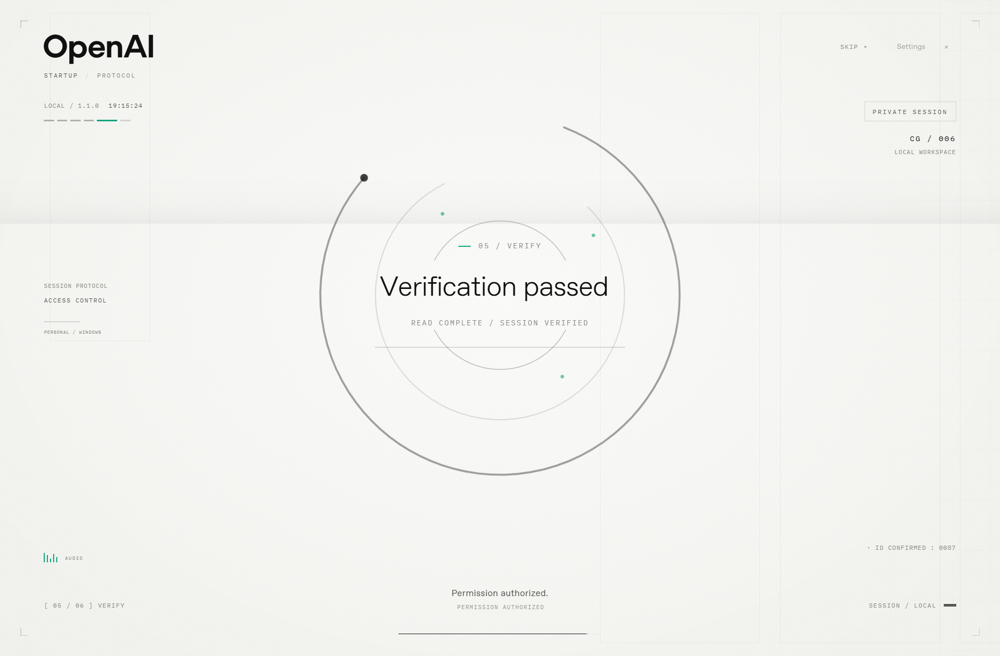

# ChatGPT Startup Screen

A personal Windows launcher with an English startup animation adapted from
[dsh-startup-screen](https://github.com/6shenhonghong9/dsh-startup-screen).
An OpenAI wordmark introduction, vector tracing, archive-style access screens,
verification rings and a welcome reveal lead into your installed desktop app.

**Unofficial personal customization.** This project is not developed or endorsed
by OpenAI. The access and verification messages are visual effects; they do not
authenticate your account or inspect your files.



## What it preserves

- The original introduction, two confirmations, vector sequence, permission
  readout, verification, welcome, dispersion and light sweep.
- All 33 original configuration fields and the original animation stylesheet.
- The eight original audio clips in local builds, with playback synchronized to
  each stage and cancellable when skipping.
- The original React settings panel, with English labels and controls for audio
  source and both dispersion colors.

The layout uses a monochrome palette, quiet green indicators, local OpenAI Sans
and IBM Plex Mono. OpenAI appears in the header and introduction; ChatGPT appears
in the welcome frame. The two Windows shortcuts use a monochrome Blossom icon;
the settings shortcut adds a small gear in the lower right. Each ICO includes
ten sizes from 16 to 256 pixels.

## Build

Requirements:

- Windows 10/11 x64 with .NET Framework 4.x and its C# compiler.
- [Node.js](https://nodejs.org/) 20 or newer on PATH.
- [Microsoft WebView2 Evergreen Runtime](https://developer.microsoft.com/en-us/microsoft-edge/webview2/).
- Internet access for the first build; verified downloads are then cached locally.

Clone this repository, open PowerShell in its directory, then run:

```powershell
powershell -NoProfile -ExecutionPolicy Bypass -File .\build.ps1
```

The build automatically runs `prepare.ps1`. It downloads the pinned upstream
archive, WebView2 SDK and fonts from their publishers and verifies every download
against `assets/dependencies.lock.json`. Dependencies with mismatched checksums
stop the build. No npm installation is needed.

The resulting launcher is `build\app\ChatGPTStartup.exe`. The target is the
registered Windows application `OpenAI.Codex_2p2nqsd0c76g0!App`, matching the desktop
application this customization was built for. The same registered application
must be installed for the final launch step to work. Preview and settings can
run without launching it.

## Install and use

Run this from a regular Windows PowerShell or Windows Terminal session:

```powershell
powershell -NoProfile -ExecutionPolicy Bypass -File .\install.ps1
```

The installer copies the build into the current user's
`AppData\Local\ChatGPTStartup` folder and creates two desktop and Start menu
shortcuts:

| Shortcut | Action |
| --- | --- |
| **ChatGPT - Startup** | Play the sequence, then open the installed app |
| **ChatGPT - Startup Settings** | Edit preferences and preview the sequence |

Select **Grant access** and **Confirm identity**, or press Enter / Space.
Esc or **Skip** opens the installed app directly. Disable **Require confirmation**
in settings for automatic playback. Save settings before selecting **Preview**.

The original application shortcut still opens the application directly. This
launcher does not patch its package or register a Windows login task. Settings
remain in `data\config.json` beside the launcher and survive reinstalling.
Logs are in `data\startup.log`.

All animation and audio resources are local after building. The WebView2 host
serves only its own internal origin, `https://chatgpt-startup.local`.

To uninstall, close the launcher and remove its desktop/Start menu shortcuts and
installation folder. The original application remains installed.

## Verify

Run the adapted frontend checks after building:

```powershell
node .\adapted\test\smoke-splash.mjs
node .\adapted\test\smoke-client.mjs
node .\adapted\test\smoke-desktop-boot.mjs
```

Run native rendering, configuration and audio checks:

```powershell
$verification = Start-Process .\build\app\ChatGPTStartup.exe -ArgumentList '--self-test' -Wait -PassThru
if ($verification.ExitCode -ne 0) { throw 'Native verification failed.' }
```

This muted test records real audio start/end events, captures every stage and
checks settings persistence, English text, fonts, skipping and compact layout.
Reports and screenshots are written to `build\app\test-data`.
The upstream Node webserver is not part of this native launcher.

| Launcher option | Action |
| --- | --- |
| `--preview` | Play without opening the target application |
| `--settings` | Open settings |
| `--self-test` | Run muted native verification |
| `--verify-launch` | Open the registered app and save its returned process ID locally |

## Source and credits

The animation engine is pinned to upstream v1.1.0, commit
`4a2cfe642867fac013fdef90095981544a819a2a`, by Shen Honghong (沈宏宏).
`src/adapt-runtime.mjs` records the rendering and timing changes against that
version; `src/english.mjs` supplies the English text. The original stylesheet
remains unchanged, with visual overrides in `src/web/brand.css`.
`build/app/SOURCE-PRESERVATION.json` records all settings and checksums verifying
that the eight downloaded audio files are unchanged.

Code and documentation are under [MIT](LICENSE). Brand assets, fonts and original
audio have separate rights, described in [Third-party notices](THIRD-PARTY-NOTICES.md).
The public repository excludes audio binaries, OpenAI Sans font binaries,
compiled applications, installation reports and user data. A local build fetches
the original dependencies and preserves their notices.

Brand reference: [OpenAI Design Guidelines](https://openai.com/brand/).
Exact public asset sources are recorded in `assets/BRAND-SOURCES.json`.
React and React DOM 18.3.1 are MIT; IBM Plex Mono is SIL OFL 1.1.
The build also includes the original project and WebView2 license notices.
